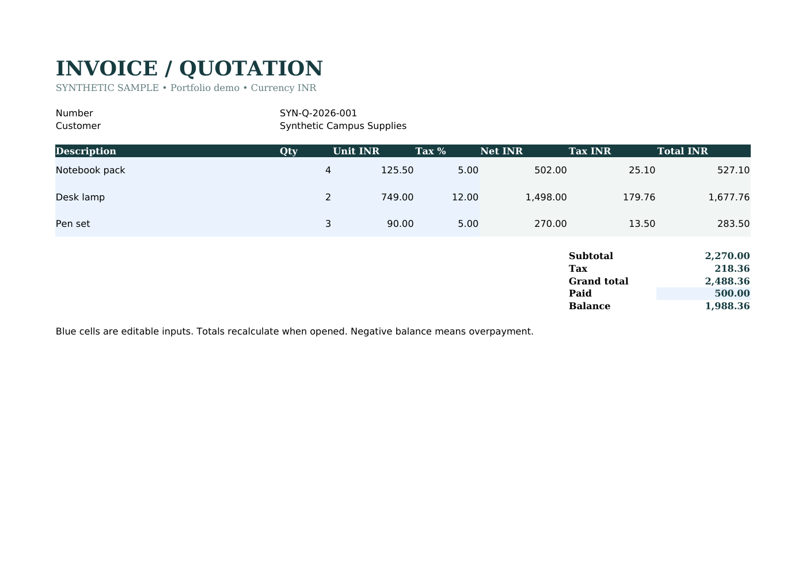

# Excel Invoice Studio

Turn a validated JSON quotation into an editable invoice workbook with line formulas, tax totals, payment summary and a print-ready layout.

## Quick start

```sh
uv sync --frozen
uv run python invoice.py sample/invoice.json invoice.xlsx
```
Python 3.10+ and uv are required. Open the result in Excel or LibreOffice; blue input cells are editable.

## Tests

`uv run python -m unittest discover -s tests -v`

## Scope and limitations

Sample quotation/invoice only, not tax or legal advice. Single INR currency; decimal prices limited to two places, quantity 1–10000, tax 0–100%. Formula values are recalculated by a spreadsheet application. Tested with LibreOffice, not Microsoft Excel. No macros, bank details or external links.

## Attribution and sample data

Built for Raj's portfolio with Wabi AI assistance. Sample data is invented and labelled synthetic; no real customer, employer or private account records are included. This is a learning/portfolio implementation, not a claim of commercial work or production deployment.

See source and tests for implementation decisions. Use invented data when exploring.

## How it works

JSON validation → Decimal reference totals → workbook formulas and editable input cells. Formula evaluation belongs to the spreadsheet engine, not openpyxl.

## Verified example

LibreOffice recalculated sample, changed quantities/payment and rounding fixture. All subtotal/tax/total/balance cells matched independent Decimal targets. Sample total INR2488.36 and balance INR1988.36. Formula cells remained formulas. Actual PDF rendering visually inspected. Microsoft Excel was not available.

See [VALIDATION.md](VALIDATION.md) for tested environments and scope.

The `examples/` folder includes the recalculated synthetic workbook, its actual PDF and preview.


